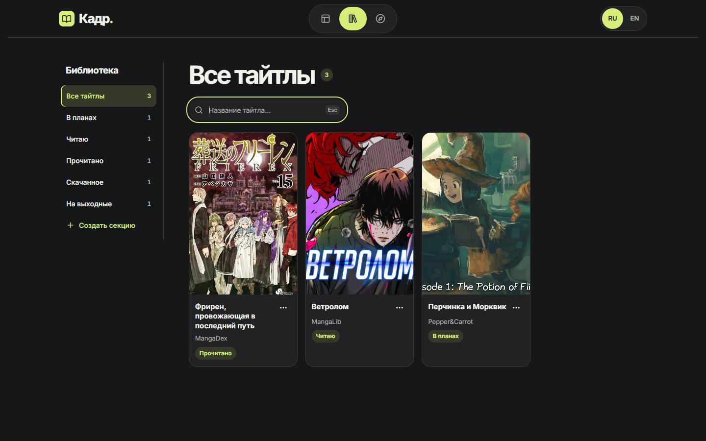
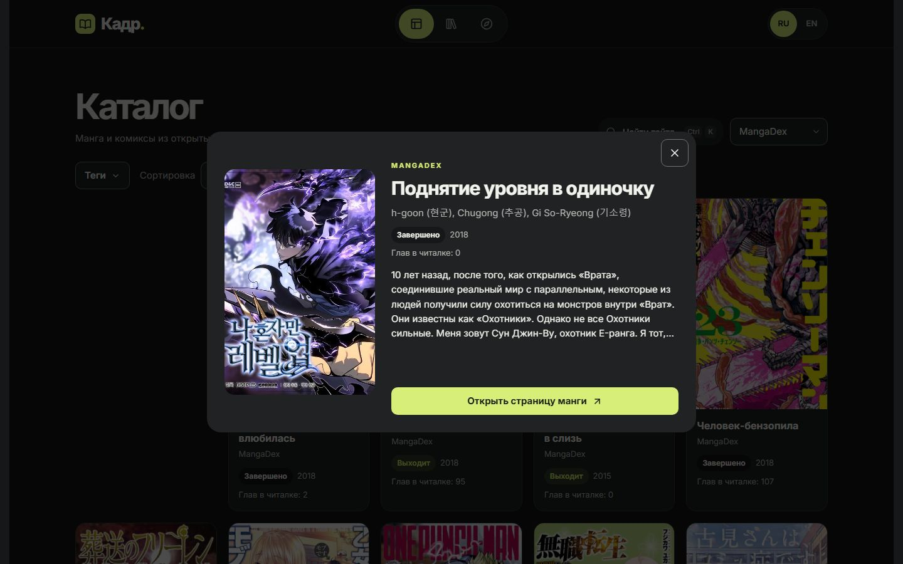
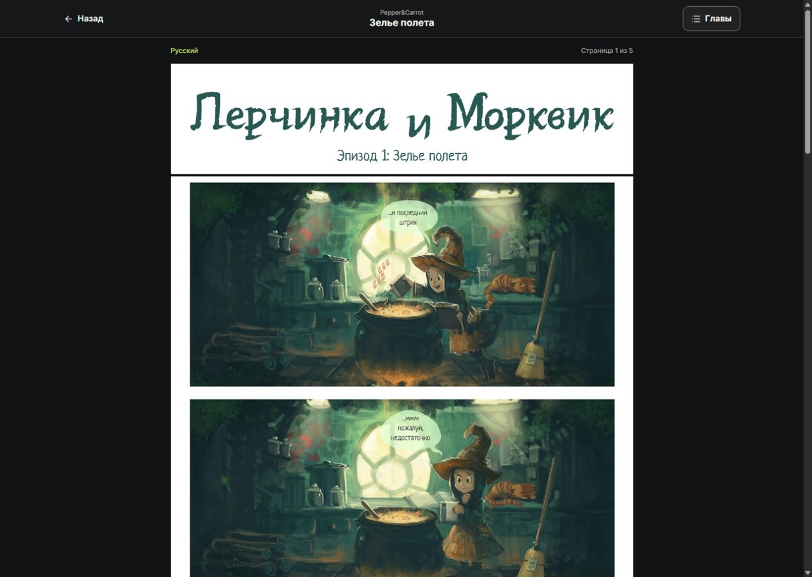
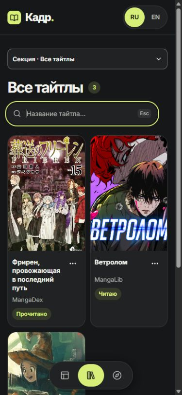

# manga-reader · Кадр

**Манга, комиксы и личная библиотека в одном локальном приложении.**

«Кадр» — веб-читалка с русскоязычным интерфейсом: подключайте источники, находите тайтлы, собирайте подборки и возвращайтесь к чтению с сохранённой страницы. Главы Pepper&Carrot можно скачать для чтения без внешнего интернета.

**Angular 21 · TypeScript · Spring Boot · Java 21 · PostgreSQL · Docker Compose**

[Возможности](#возможности) · [Интерфейс](#интерфейс) · [Запуск](#локальный-запуск-в-windows-powershell) · [Документация](#документация) · [Лицензия](#лицензия)

## Возможности

| Раздел | Что можно делать |
| --- | --- |
| **Каталог** | Выбирать источник, искать тайтлы, просматривать обложки и сведения о произведении. Для поддерживаемых источников доступны теги и сортировка. |
| **Превью и страница тайтла** | Раскрывать карточку, читать описание, смотреть теги, языки переводов и список глав. |
| **Библиотека** | Назначать статус, оставлять заметки, создавать свои секции, переименовывать их и собирать подборки. |
| **Читалка** | Читать страницы вертикально, выбирать перевод, переключать главы и продолжать с сохранённой позиции. |
| **Скачанное** | Скачивать главы Pepper&Carrot с выбранным переводом, открывать готовые копии, повторять неудачную загрузку и удалять файлы. |
| **Обзор** | Подключать и отключать доступные источники через вкладку «Расширения», открывать их каталоги. |

Переключатель **RU / EN** выбирает язык названий тайтлов из API. Язык перевода главы выбирается отдельно. При отсутствии переведённого названия используется доступный вариант.

В интерфейсе используются графитовые поверхности, светлый зелёный акцент, шрифт Inter и иконки Lucide. Общие компоненты поиска и навигации, анимация раскрытия карточки и адаптивная библиотека поддерживают единый стиль. Для `prefers-reduced-motion` предусмотрено уменьшение движения.

## Интерфейс

Скриншоты сняты с работающего приложения на разных этапах разработки. Детали текущей версии могут отличаться.

### Превью манги

Карточка раскрывается в превью с обложкой, описанием и переходом на страницу тайтла. Закрытие возвращает к выбранной карточке.

### Чтение

Основное пространство занимают страницы комикса. Навигация по главам и информация об источнике остаются доступными.

<strong>Мобильный интерфейс</strong>

На телефоне навигация находится снизу, а секции библиотеки переключаются компактным меню.

  
  

[Короткое видео: карточка → превью → страница](frontend/docs/screenshots/title-opening.webm) · [Все скриншоты](frontend/docs/screenshots/)

## Источники и офлайн-чтение

В проекте есть адаптеры **Pepper&Carrot, MangaDex, MangaLib и MangaKakalot**. Подключения управляются в разделе **«Обзор → Расширения»** и сохраняются в PostgreSQL.

Работа онлайн-источников зависит от доступности их сайтов и серверов изображений. Результаты проверок MangaLib и MangaKakalot собраны в [отчёте по источникам](backend/docs/mangakakalot-and-mangalib.md).

**Офлайн-MVP поддерживает Pepper&Carrot.** Готовые главы открываются в **«Библиотека → Скачанное»**. Файлы хранятся на машине со Spring Boot, по умолчанию в `backend/data/downloads/`. Для чтения без внешнего интернета должны работать локальные Angular, Spring Boot и PostgreSQL. MinIO для этого не требуется.

Расширение серверного каталога и восстановление чтения описаны в [плане интеграции](backend/docs/catalog-sync-and-reading-plan.md). Полнота выдачи зависит от собранных данных и состояния синхронизации источника.

## Структура

| Папка | Содержимое |
| --- | --- |
| [frontend/](frontend/README.md) | Angular 21, интерфейс «Кадр», клиент REST API, макеты и скриншоты |
| [backend/](backend/README.md) | Java 21, Spring Boot, PostgreSQL, миграции Flyway и адаптеры источников |

## Локальный запуск в Windows PowerShell

Понадобятся **JDK 21**, **Node.js 24 LTS** с npm и **Docker Desktop** с запущенным Linux Engine. Для первоначальной установки зависимостей и онлайн-контента нужен интернет. Для бэкенда и фронтенда откройте отдельные окна PowerShell в корне репозитория.

### 1. PostgreSQL и Spring Boot

~~~powershell
Set-Location backend
if (-not (Test-Path -LiteralPath .env)) {
    Copy-Item .env.example .env
}
docker compose up -d --wait postgres
Get-Content -LiteralPath .env | ForEach-Object {
    if ($_ -match '^(POSTGRES_DB|POSTGRES_USER|POSTGRES_PASSWORD|POSTGRES_PORT)=(.*)$') {
        [Environment]::SetEnvironmentVariable($Matches[1], $Matches[2], 'Process')
    }
}
.\mvnw.cmd spring-boot:run
~~~

При запуске Spring Boot применяет миграции Flyway. PostgreSQL использует постоянный именованный том. Файл `backend/.env` содержит локальные настройки и исключён из Git.

### 2. Angular

~~~powershell
Set-Location frontend
npm ci
npm start
~~~

| Сервис | Адрес по умолчанию |
| --- | --- |
| **Приложение** | [http://localhost:4200/catalog](http://localhost:4200/catalog) |
| **REST API** | [http://localhost:8080/api/v1/catalog](http://localhost:8080/api/v1/catalog) |
| **PostgreSQL** | `127.0.0.1:5432` |

Angular обращается к относительным адресам `/api/v1`. [Dev proxy](frontend/proxy.conf.json) перенаправляет `/api/**` на `http://127.0.0.1:8080`. По умолчанию сервисы доступны с локальной машины.

После запуска откройте **«Обзор → Расширения»**, подключите нужный источник и перейдите в его каталог. Для знакомства с чтением и скачиванием используйте Pepper&Carrot.

### Остановка

Остановите Angular и Spring Boot сочетанием **Ctrl+C** в соответствующих окнах. Затем из `backend/`:

~~~powershell
docker compose stop
~~~

Команда сохраняет контейнер и данные PostgreSQL для следующего запуска.

## Сборка и тесты

| Папка | Команда | Результат |
| --- | --- | --- |
| `frontend/` | `npm run build` | Сборка Angular в `dist/kadr/browser/` |
| `backend/` | `.\mvnw.cmd -B -ntp verify` | Тесты и JAR в `target/`. Для интеграционных тестов нужен Docker. |

Подробности о маршрутах, переменных окружения и проверках приведены в [документации фронтенда](frontend/README.md) и [документации API](backend/README.md).

Проверить маршрут Angular proxy при работающих сервисах:

~~~powershell
Invoke-RestMethod 'http://localhost:4200/api/v1/catalog'
~~~

Для размещения сборки фронтенда веб-сервер должен возвращать `index.html` для маршрутов Angular и проксировать `/api/` на Spring Boot.

## Документация

- [Фронтенд: запуск, компоненты, интерфейс и проверки](frontend/README.md).
- [Бэкенд: настройка, REST API и модель данных](backend/README.md).
- [Источники и расширения](backend/docs/sources-implementation-report.md).
- [Офлайн-чтение: реализация и проверки](frontend/docs/catalog-and-offline-report.md).
- [Переход карточка → превью → страница](frontend/docs/title-opening-report.md).
- [Общий поиск CommandSearch](frontend/docs/library-command-report.md).
- [Магнитные кнопки и анимации](frontend/docs/magnetic-button-report.md).

## Лицензия

Исходный код проекта распространяется по [MIT License](LICENSE).

Copyright © 2026 amws. Разрешены использование, изменение и распространение кода, включая коммерческое, с сохранением уведомления об авторских правах и текста лицензии. Программное обеспечение предоставляется «как есть», без гарантий.

### Сторонние материалы

Лицензия кода приложения не меняет условия использования зависимостей, сторонних компонентов, шрифтов, персонажей загрузки и иллюстраций. Манга и обложки принадлежат соответствующим правообладателям; скриншоты демонстрируют интерфейс и содержат материалы источников.

Pepper&Carrot создан **David Revoy** и распространяется по **CC BY 4.0**; авторство и ссылка на лицензию отображаются в приложении. Источники персонажей загрузки перечислены в [документации фронтенда](frontend/README.md#заставка-ожидания). Уведомления об авторстве заимствованных компонентов следует сохранять.
